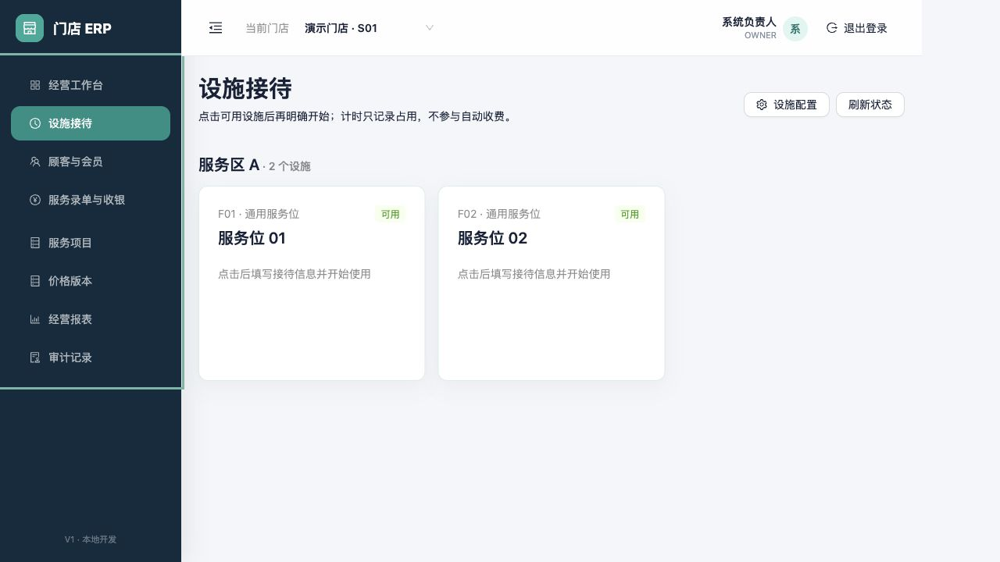
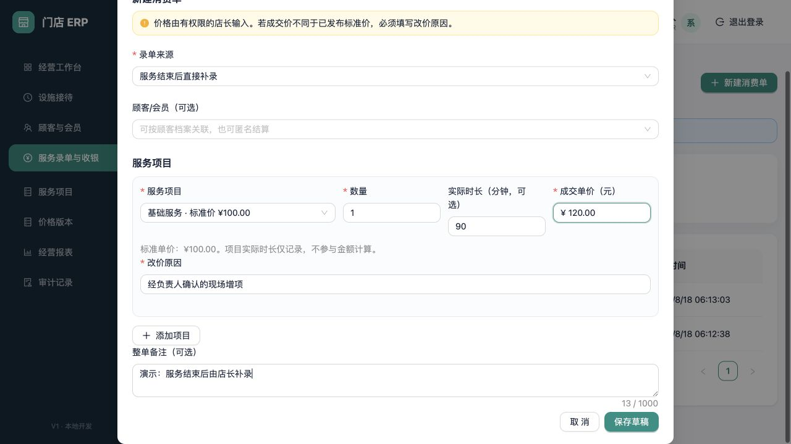
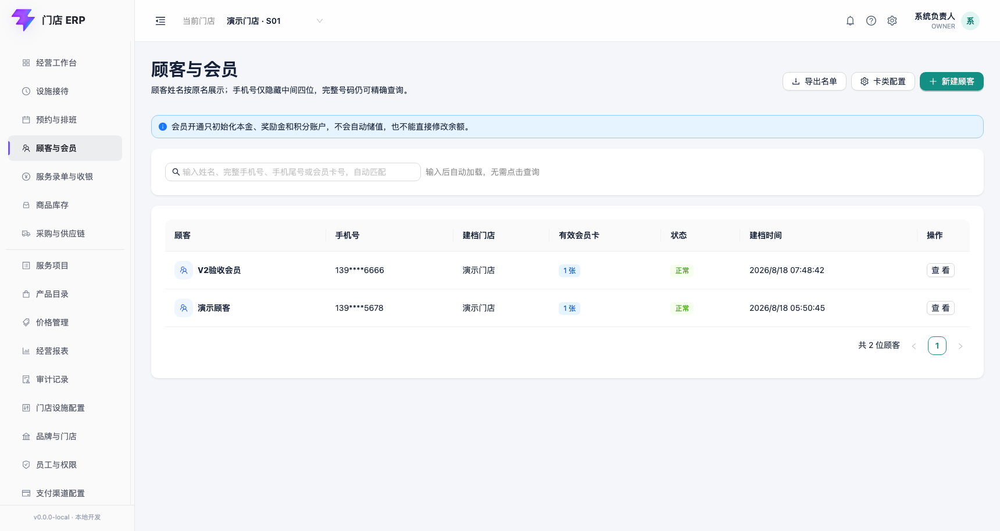
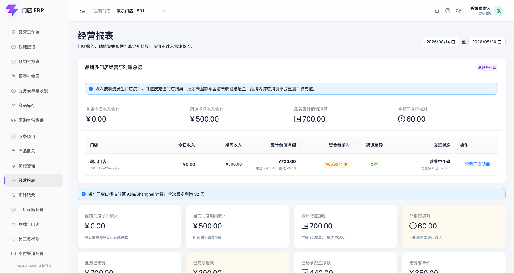

<div align="center">

# 门店 ERP · Store ERP

**为服务型连锁门店（足疗、美业、养生、按摩、修脚等）打造的自托管收银 + 会员储值 + 库存系统**

**Self-hosted POS, membership, and inventory for service-based chain stores (spas, salons, massage, wellness)**

[English](#english) · [中文](#中文) · 在线 Demo：TODO · [文档 Docs](docs/user-manual/README.md) · [更新日志 Changelog](CHANGELOG.md)


演示动图：TODO（仓库里还没有 `docs/assets/readme/demo.gif`）

</div>

---

## 中文

### 它解决什么问题

一家开了多家店的足疗 / 美业 / 养生品牌，每天要处理：顾客到店占床位、技师做完服务、前台按实际项目收钱、会员卡扣储值、送的钱不能先花、月底算技师提成、老板想看每家店的营业额。市面上的 SaaS 收银按店按年收费、数据在别人服务器上；通用 ERP（Odoo、ERPNext）又是为制造和贸易设计的，没有“床位计时”“储值本金/赠送分账”“技师提成”这些门店概念。

门店 ERP 把这条链路做成一套可以部署在自己服务器上的系统：

```text
预约 / 到店 → 占用设施并计时 → 录入实际服务与商品 → 改价按策略审批
           → 现金 / 会员 / 人工渠道 / 官方微信或支付宝结算
           → 库存、会员、提成、审计在同一事务入账 → 收款核对 → 经营报表
```

### 核心功能

| 模块 | 能做什么 |
|---|---|
| 设施接待 | 床位 / 房间 / 仪器看板。开始、暂停、继续、换位、结束，按秒计时。计时只记录占用，不自动收费 |
| 收银 | 服务与商品可以单独或混合下单。成交价偏离标准价时，负责人可直接确认，店长在当前改价策略内可直接确认，其余情况走审批。支持分摊收款、预结小票、结算小票和营业日报 |
| 会员 | 会员卡把储值本金和赠送奖励分开记账，消费必须先扣完同一张卡的本金。次卡先扣购买次数再扣赠送次数。积分按批次和到期日扣减。支持部分退款与冲正 |
| 员工 | 角色为负责人、店长、前台、收银员、服务员工，可兼职，并受门店范围约束。岗位提成和按服务项目提成分开核算，有提成明细 |
| 库存与供应链 | 销售预占、批次和效期、盘点审批、跨店调拨、供应商和采购入库 |
| 多门店 | 一个品牌（租户）下多家店共享顾客和会员权益。门店是业务发生地和员工授权范围。不同品牌的数据按 `tenant_id` 隔离 |
| 审计与报表 | 业务审计只追加写入；平台审计在数据库里禁止修改和删除。经营报表可按门店、日期、项目和员工查看 |
| 经典界面 | 另外提供 `/ui/new`。清单里有 12 个模块、199 个页面，沿用传统门店软件的操作顺序。已经接通的功能进入真实业务页；还没有后端的页面会标明不能保存，不会假装保存成功。短信模块目前只有界面位置 |

### 为什么值得一看（工程角度）

- **金额用整数分**（字段以 `minor` 结尾）。会员账户、库存移动、次卡和积分流水只追加；纠错走退款、冲正或反向单据。
- **订单保存价格快照**。之后改目录或改价，不会重算旧单。
- **隐藏按钮不等于授权**。菜单、路由、按钮和 API 都检查权限。API 同时检查门店范围、业务状态和并发版本。生产构建不会启用前端权限跳过开关。
- **模块化单体**：ASP.NET Core 10、EF Core 10、Npgsql、PostgreSQL 18、只向前的 Flyway SQL；React 19、TypeScript 6、Vite 8、Ant Design 6、TanStack Query。文档中的生产基线是 Ubuntu 24.04 上的 2 核 4 GB 单机，不使用 Kubernetes。
- **CI**（`.github/workflows/ci.yml`）在 Ubuntu 24.04 上构建并用警告当错误，跑 xUnit（含真实 PostgreSQL 集成测试）、Oxlint、Vitest、前端生产构建，以及 `dotnet list package --vulnerable` 和 `npm audit`。仓库里目前没有 Playwright 工程，CI 也不跑浏览器端到端测试。
- **生产部署**：Nginx、systemd、Blue/Green 槽位、发布前备份、Flyway 只向前迁移。脚本在 `deploy/linux/`。

### 快速开始

一键演示：TODO。仓库里还没有同时启动 PostgreSQL、API 和 Web 的 `compose.demo.yaml`，也没有演示种子数据包。

**从源码运行（当前可用）。** 需要：

- .NET SDK 10.0.301（`global.json` 允许同一 10.0 的更新补丁）
- Node.js 24（CI 使用 `24.x`）
- Docker 与 Docker Compose
- 本机 `psql` 客户端

`compose.yaml` 只启动 PostgreSQL 18.4，端口是 `127.0.0.1` 上的 `ERP_DB_PORT`（默认 `54318`）。API 不会自动建表。

```bash
git clone https://github.com/JesstLe/erp.git
cd erp
cp .env.example .env
# 编辑 .env，把每个 CHANGE_ME 换成只在本机使用的值。
# ERP_SEED_OWNER_PASSWORD 至少 8 位，并且同时包含英文字母和数字。

set -a
source .env
set +a

docker compose up -d postgres
# 等健康检查通过后再执行迁移：docker compose ps

# 一次性本地空库。按文件名顺序执行 db/migrations/V*.sql。
# 不会写入 flyway_schema_history。共享环境和生产环境改用 Flyway，见 db/README.md。
for migration in db/migrations/V*.sql; do
  PGPASSWORD="$POSTGRES_PASSWORD" psql -h 127.0.0.1 -p "${ERP_DB_PORT:-54318}" \
    -U "$POSTGRES_USER" -d "$POSTGRES_DB" -v ON_ERROR_STOP=1 -f "$migration" || exit 1
done

npm --prefix apps/web ci
```

终端 1，启动 API。`http` 配置监听 `http://localhost:5080`：

```bash
set -a; source .env; set +a
dotnet run --project apps/api/Erp.Api --launch-profile http
```

终端 2，启动前端。开发服务器绑定 `http://127.0.0.1:5173`，并把 `/api` 和 `/health` 代理到 `http://localhost:5080`：

```bash
npm --prefix apps/web run dev
```

浏览器打开 <http://127.0.0.1:5173>。源码里没有写死密码。只有 Development 环境且 `ERP_SEED_OWNER_PASSWORD` 非空时，启动 API 才会创建演示品牌 `B01`、门店 `S001` 和负责人账号 `owner01`（员工号 `E0001`）。用你在 `.env` 里设置的密码登录 `owner01`。

### 截图

截图来自本地虚构数据。

| 设施接待 | 新建消费单 |
|---|---|
|  |  |
| **顾客与会员** | **经营报表** |
|  |  |

TODO：用有内容的演示数据重拍。上面的设施看板只有两个空闲服务位。

### 当前状态与边界

- 已形成闭环：品牌门店、权限、目录价格、设施接待、预约排班、会员储值、收银退款、库存、供应链、审计、报表。
- 当前收款不再强制开班或交班。历史班次数据仍保留。
- 默认可用的外部收款是人工登记：微信、支付宝、银行卡、团购平台核销。官方微信支付 Native 和支付宝订单码的交易、验签、查单、退款、日账单对账代码已经在仓库里，默认关闭，需要你自己的商户凭据和验收之后才能收真实资金。
- 供应链目前是供应商、采购入库、批次效期、盘点审批和跨店调拨。完整采购订单、应付账款和会计凭证仍不在范围内。
- 员工提成是结算时锁定的核算数据，不是工资发放。
- 短信只有经典界面占位，供应商发送尚未接入。
- 界面语言目前只有简体中文。国际化：TODO。

进度见 [开发进度](docs/development-progress.md) 和 [CHANGELOG](CHANGELOG.md)。

### 文档

- [用户手册（20 章）](docs/user-manual/README.md)
- [核心业务逻辑](docs/core-business-logic.md) · [技术架构](docs/technical-architecture-and-stack.md) · [数据库治理](docs/database-design-and-change-governance.md)
- [本地数据库初始化](db/README.md) · [Linux 部署](docs/linux-server-deployment-baseline.md) · [Linux 脚本](deploy/linux/README.md) · [发布、备份与恢复](docs/v2-release-and-recovery.md)
- [旧系统只读迁移工具](tools/Erp.LegacyMigration/README.md)

### 参与贡献

欢迎提 [Issue](https://github.com/JesstLe/erp/issues) 和 Pull Request。可以从 [`good first issue`](https://github.com/JesstLe/erp/labels/good%20first%20issue) 开始。

贡献指南：TODO（仓库里还没有 `CONTRIBUTING.md`）。

有门店试点或使用方面的联络：GitHub Discussions TODO（当前未开启）。联系方式：TODO。

### 许可

Copyright (c) 2026 Jessy Le。本项目以 [MIT License](LICENSE) 发布。你可以自由使用、复制、修改、分发和出售本软件（包括门店自行经营、托管和嵌入其他产品），只需在副本中保留上述版权声明和许可声明。软件按“原样”提供，不含任何明示或暗示担保。

---

## English

### What it is

Store ERP is a self-hosted point-of-sale, membership, and inventory system for **service-based chains** — foot spas, massage, beauty salons, and wellness brands with more than one location. General-purpose ERPs such as Odoo and ERPNext are built around manufacturing and trading. They do not model “this bed has been occupied for 47 minutes”, “prepaid principal versus bonus on a member card”, or “technician commission per service”. This project does.

```text
Booking / walk-in → occupy a room or bed and time it → enter the actual services and products
  → approve off-list prices under the active policy
  → settle with cash, member balance, a manually recorded channel, or official WeChat Pay / Alipay
  → inventory, membership, commission, and audit commit in one transaction
  → reconcile external payments → reports
```

### Features

- **Reception board** — rooms, beds, and devices. Start, pause, resume, switch, and finish, timed in seconds. Timing never creates a charge.
- **Cashier** — service-only, product-only, or mixed orders. The owner can confirm an off-list price directly; a store manager can confirm one inside the active price-override policy; everyone else waits for approval. Split tenders, pre-bills, settlement receipts, and a daily revenue report.
- **Membership** — principal and bonus balances are separate ledgers, and bonus cannot be spent until that card’s principal is zero. Service passes consume purchased visits before bonus visits. Points are batches with expiry, spent earliest-expiry first. Partial refunds and reversals append new ledger rows.
- **Staff** — owner, store manager, front desk, cashier, and technician. A person may hold several roles, still limited to assigned stores. Position commissions and per-service commissions are calculated separately.
- **Inventory and supply chain** — sales reservations, lots and expiry, stock-take approval, inter-store transfers, suppliers, and purchase receipts.
- **Multi-store** — stores in one brand (tenant) share customers and member benefits. A store is where the business happened and which staff may act. Other brands are isolated by `tenant_id`.
- **Audit and reports** — business audit events are append-only in the application; platform audit events reject updates and deletes in the database. Reports break down revenue by store, day, service, and employee.
- **Classic UI** — `/ui/new` keeps a traditional store-software layout: 12 modules and 199 catalogued pages. Wired features open the real screens. Pages without a backend say they cannot save. SMS is still only a placeholder.

### Engineering notes

- Money is integer minor units (分), in columns suffixed `minor`. Member accounts, inventory movements, service passes, and point grants are append-only. Corrections are refunds, reversals, or reversing documents.
- Orders store a price snapshot, so later catalog edits do not rewrite history.
- Hiding a control is not authorization. Menus, routes, buttons, and the API all check permissions. The API also checks store scope, business state, and the concurrency version. The frontend permission bypass exists only when a development build sets `VITE_LOCAL_AUTHORIZATION_BYPASS=true`.
- Modular monolith: ASP.NET Core 10, EF Core 10, Npgsql, PostgreSQL 18, forward-only Flyway SQL; React 19, TypeScript 6, Vite 8, Ant Design 6, TanStack Query. The documented production baseline is one Ubuntu 24.04 machine with 2 vCPU and 4 GB of RAM. Kubernetes is not part of this layout.
- CI (`.github/workflows/ci.yml`) on Ubuntu 24.04 builds with warnings as errors and runs xUnit, including real PostgreSQL integration tests, Oxlint, Vitest, the frontend production build, `dotnet list package --vulnerable`, and `npm audit`. There is no Playwright project in the repo, and CI does not run browser end-to-end tests.
- Production deploy: Nginx, systemd, blue/green slots, a backup before release, and forward-only Flyway. Scripts live in `deploy/linux/`.

### Quick start

One-command demo: TODO. The repo does not yet include a `compose.demo.yaml` that starts PostgreSQL, the API, and the web app, and it does not ship a demo seed.

**From source (works today).** You need:

- .NET SDK 10.0.301 (`global.json` allows a newer patch of 10.0)
- Node.js 24 (CI uses `24.x`)
- Docker and Docker Compose
- a local `psql` client

`compose.yaml` starts PostgreSQL 18.4 only, published on `127.0.0.1` at `ERP_DB_PORT` (default `54318`). The API does not create the schema.

```bash
git clone https://github.com/JesstLe/erp.git
cd erp
cp .env.example .env
# Edit .env and replace every CHANGE_ME with a local value.
# ERP_SEED_OWNER_PASSWORD must be at least 8 characters and contain a letter and a digit.

set -a
source .env
set +a

docker compose up -d postgres
# Wait until the healthcheck is up: docker compose ps

# Disposable local database. Applies db/migrations/V*.sql in filename order.
# This does not write flyway_schema_history. Shared and production databases use Flyway; see db/README.md.
for migration in db/migrations/V*.sql; do
  PGPASSWORD="$POSTGRES_PASSWORD" psql -h 127.0.0.1 -p "${ERP_DB_PORT:-54318}" \
    -U "$POSTGRES_USER" -d "$POSTGRES_DB" -v ON_ERROR_STOP=1 -f "$migration" || exit 1
done

npm --prefix apps/web ci
```

Terminal 1 starts the API. The `http` profile listens on `http://localhost:5080`:

```bash
set -a; source .env; set +a
dotnet run --project apps/api/Erp.Api --launch-profile http
```

Terminal 2 starts the web app on `http://127.0.0.1:5173`. It proxies `/api` and `/health` to `http://localhost:5080`:

```bash
npm --prefix apps/web run dev
```

Open <http://127.0.0.1:5173>. No password is hardcoded. On a Development launch, when `ERP_SEED_OWNER_PASSWORD` is non-empty, the API creates demo brand `B01`, store `S001`, and owner account `owner01` (employee `E0001`). Sign in as `owner01` with the password you set.

### Status

The core loop is in place. Checkout no longer requires opening or closing a cashier shift; historical shift rows remain. Default external tenders are manual records for WeChat, Alipay, bank card, and group-buy redemption. Official WeChat Pay Native and Alipay QR (create, verify, query, refund, daily bill reconciliation) are implemented and disabled until you supply merchant credentials and finish acceptance testing. The UI is simplified Chinese only (internationalization: TODO).

### Docs

- [User manual, 20 chapters](docs/user-manual/README.md)
- [Business rules](docs/core-business-logic.md) · [Architecture](docs/technical-architecture-and-stack.md) · [Database change rules](docs/database-design-and-change-governance.md)
- [Local database setup](db/README.md) · [Linux deployment](docs/linux-server-deployment-baseline.md) · [Release, backup, and recovery](docs/v2-release-and-recovery.md)

### Contributing

Issues and pull requests are welcome. A starting point is [`good first issue`](https://github.com/JesstLe/erp/labels/good%20first%20issue).

Contributing guide: TODO (`CONTRIBUTING.md` is not in the repo yet).

Store pilots and direct contact: GitHub Discussions TODO (discussions are not enabled). Contact: TODO.

### License

Copyright (c) 2026 Jessy Le. This project is released under the [MIT License](LICENSE). You may use, copy, modify, merge, publish, distribute, sublicense, and sell it, including running your own stores, hosting it, or embedding it in another product, as long as the copyright and permission notices stay with the software. It is provided “as is”, without warranty.
